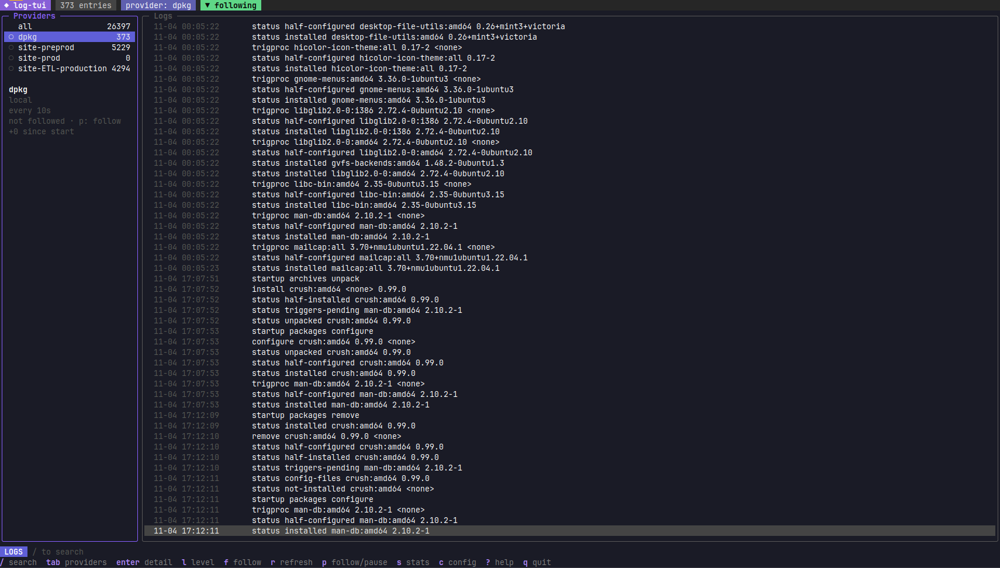

# log-tui

A terminal dashboard (TUI) for monitoring logs from local files, remote files over SFTP, remote commands over SSH, and HTTP(S) endpoints. Entries are fetched periodically, stored in a local SQLite database, and can be searched, filtered, inspected and notified on, all from the terminal.

The interface is available in **English** and **French**.



## Features

- **Providers**: `local`, `sftp`, `ssh` (run a command and keep only new lines) and `http` (Range requests when supported).
- **Incremental reads**: SFTP and local providers only read new bytes; rotation (truncation / new file) is detected.
- **Dated paths and globs**: `%Y %y %m %d %H %j` in paths (e.g. `/var/log/api/prod-%Y-%m-%d.log`) and wildcards (the most recently modified match is followed). Per-provider `timezone`.
- **SSH**: `~/.ssh/config` aliases, key, ssh-agent, password, passphrase, `known_hosts`. `${VAR}` expansion in secrets, headers and paths.
- **SQLite store** with optional `retention` (purge of old entries). Pure Go, no cgo.
- **Detail view** with automatic format detection: JSON, Monolog/Laravel, nginx/Apache access logs, syslog, logfmt. Embedded JSON is pretty-printed.
- **Search language**: free text, phrases, exclusions, level, provider, time window and JSON fields.
- **Statistics panel**: counts per level, activity sparkline, most frequent messages.
- **In-app config editor** (`c`): validates, saves atomically and hot-reloads.
- **Error notifications** when the terminal is not focused (`notify-send`, otherwise OSC 99 / OSC 9 terminal sequences).

## Installation

Quick install (Linux and macOS, amd64 and arm64):

```sh
curl -fsSL https://raw.githubusercontent.com/boutdecode/log-tui/main/install.sh | bash
```

The script installs the latest release into `/usr/local/bin` (if writable) or `~/.local/bin`, and verifies its checksum. Set `LOG_TUI_VERSION=v1.0.0` to pin a version or `LOG_TUI_INSTALL_DIR=/some/dir` to choose the target. If no release exists yet, it builds from source (`git` and Go required).

Releases are built by GitHub Actions when a `v*` tag is pushed.

### From source

Requires Go (see `go.mod` for the minimum version).

```sh
go build -o log-tui ./cmd/log-tui
# or
go install ./cmd/log-tui
```

## Usage

```sh
log-tui [-config path] [-transparent] [-lang fr|en]
```

| Flag           | Description                                                                 |
| -------------- | --------------------------------------------------------------------------- |
| `-config`      | Path to the YAML configuration (default: `~/.config/log-tui/config.yaml`)   |
| `-transparent` | Keep the terminal background instead of painting a colored one              |
| `-lang`        | Interface language: `fr` or `en` (default: detected from the system locale) |

On first run with the default config path, an example configuration is created. Both `-lang` and `--lang` are accepted.

### Language

The language is chosen in this order:

1. `--lang fr|en`
2. the system locale: `LC_ALL`, then `LC_MESSAGES`, then `LANG` (any `fr*` locale selects French)
3. English

This applies to the TUI, `-h` output, error messages and the generated example configuration.

```sh
log-tui --lang fr
LANG=fr_FR.UTF-8 log-tui
```

## Configuration

```yaml
db: ~/.local/share/log-tui/logs.db   # default
retention: 168h                      # absent = never purge
notify: true
notify_cooldown: 10s

providers:
  - name: dpkg
    type: local
    path: /var/log/dpkg.log
    interval: 10s
    follow: true                     # default: false (press p in the TUI to follow)

  - name: api-prod
    type: sftp
    host: prod-1                     # ~/.ssh/config alias accepted
    user: deploy
    path: /var/log/api/prod-%Y-%m-%d.log
    timezone: Europe/Paris
    interval: 10s
    initial_bytes: 2097152           # first fetch: last 2 MiB (default 1 MiB)

  - name: systemd
    type: ssh
    host: prod-1
    command: journalctl -u api -n 500 --no-pager -o short-iso
    interval: 15s

  - name: nginx-http
    type: http
    url: https://logs.example.com/nginx/error.log
    headers:
      Authorization: Bearer ${LOG_TOKEN}
    interval: 30s
```

The default `interval` is 30s. A fully commented example is generated on first run.

## Key bindings

| Key                | Action                                              |
| ------------------ | --------------------------------------------------- |
| `↑/↓`, `j/k`       | Navigate                                            |
| `pgup/pgdn`        | Half page                                           |
| `g` / `G`          | Top / bottom                                        |
| `f`                | Follow new logs                                     |
| `enter`            | Entry detail (`←/→` previous/next entry)            |
| `tab`              | Focus the providers list                            |
| `/`                | Search                                              |
| `esc`              | Clear filter / go back                              |
| `l`                | Level filter (all → ≥error → ≥warn → ≥info)         |
| `r`                | Refresh all                                         |
| `p`                | Follow / pause the selected provider                |
| `s`                | Statistics                                          |
| `c`                | Edit configuration (`ctrl+s` to save and apply)     |
| `?`                | Help                                                |
| `q`, `ctrl+c`      | Quit                                                |

## Search syntax

| Query                | Meaning                                       |
| -------------------- | --------------------------------------------- |
| `timeout`            | Case-insensitive substring                    |
| `"connection reset"` | Phrase                                        |
| `-healthcheck`       | Exclude                                       |
| `level:error,warn`   | Level(s)                                      |
| `provider:api`       | Source                                        |
| `since:15m`          | Time window (`s`, `m`, `h`, `d`)              |
| `user.id:42`         | Substring in a JSON field (dotted path)       |

## Notifications

New `error`/`fatal` entries trigger a notification while the terminal is unfocused. Under tmux, enable focus events: `set -g focus-events on`.

## Development

```sh
go test ./...
```
